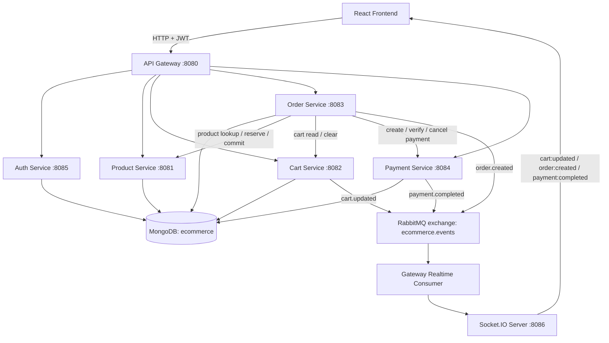

# Ecommerce Backend — Spring Boot Microservices

A migration of the ecommerce backend from Node.js to Java/Spring Boot. The system is split into independent services, with a Gateway as the public HTTP entry point and RabbitMQ for realtime event delivery.

## Architecture

## Services

| Service | Port | Responsibility |
|---|---:|---|
| Gateway | 8080 | HTTP routing, JWT validation, trusted customer identity, RabbitMQ consumer and Socket.IO server |
| Product | 8081 | Product listing/details and inventory reservations |
| Cart | 8082 | Customer cart operations and `cart.updated` event |
| Order | 8083 | Checkout preparation/confirmation/cancellation and order history |
| Payment | 8084 | Razorpay order creation, verification and cancellation |
| Auth | 8085 | Signup, login and JWT issuance |
| Socket.IO | 8086 | Browser realtime connection and customer-room event delivery |

## Main flows

### Login and API requests
1. The frontend signs up or logs in through `/api/auth/**`.
2. Auth returns a JWT.
3. The frontend sends `Authorization: Bearer <token>` to protected APIs.
4. The Gateway validates the JWT and sets `X-Customer-Id` from the verified token; a client-supplied customer ID must not be trusted.
5. The Gateway routes the request to the relevant service.

### Checkout
1. The frontend calls `POST /api/orders/prepare`.
2. Order coordinates cart/product checks, inventory reservation and payment-order creation.
3. The frontend completes the Razorpay payment and calls `POST /api/orders/confirm`.
4. Order verifies payment, commits the inventory reservation, clears the cart and confirms the order.
5. Services publish realtime events through RabbitMQ.

### Realtime events
Services publish to the `ecommerce.events` fanout exchange. The Gateway consumer forwards events to the customer's Socket.IO room:

| RabbitMQ event | Browser event |
|---|---|
| `cart.updated` | `cart:updated` |
| `order.created` | `order:created` |
| `payment.completed` | `payment:completed` |

The frontend currently connects to Socket.IO at `http://localhost:8086`. Keep the frontend origin aligned with `app.realtime.allowed-origin` in Gateway configuration.

## API routes

- Auth: `POST /api/auth/signup`, `POST /api/auth/login`
- Products: `GET /api/products`, `GET /api/products/{productId}`
- Cart: `GET /api/cart`, `POST /api/cart/items`, `PATCH /api/cart/items/{productId}`, `DELETE /api/cart/items/{productId}`, `DELETE /api/cart`
- Orders: `GET /api/orders`, `POST /api/orders/prepare`, `POST /api/orders/confirm`, `POST /api/orders/cancel`
- Payments: `GET /api/payments/provider`, `GET /api/payments/razorpay/key`, `POST /api/payments/razorpay/order`, `POST /api/payments/razorpay/verify`, `POST /api/payments/razorpay/cancel`
- Internal inventory reservation routes are under `/api/products/reservations/**`.

## Local prerequisites

- Java 17+
- Maven (or the included `mvnw` wrapper in each service)
- MongoDB at `localhost:27017`, database `ecommerce`
- RabbitMQ at `localhost:5672`; the configured exchange is `ecommerce.events`
- Razorpay test credentials for payment testing
- React frontend configured to use the Gateway at `http://localhost:8080`

Each service has its own Maven project under `server/<service>`. Start MongoDB and RabbitMQ first, then start Product, Cart, Payment, Order, Auth and Gateway. For example, from a service directory run `./mvnw spring-boot:run` (Windows: `mvnw.cmd spring-boot:run`). Start each service in a separate terminal.

## Configuration and security notes

- Service ports, URLs, MongoDB, RabbitMQ and Socket.IO settings are configured in each service's `src/main/resources/application.properties`.
- Use the same `JWT_SECRET` value for Auth and Gateway if both are configured through that environment variable. Do not commit production secrets; rotate any credentials that have been committed.
- Socket.IO JWT authentication is a separate task from HTTP Gateway JWT validation. If socket handshake authentication has not been implemented, do not treat customer-room access as authenticated.
- This README documents the current project flow; it is not a claim that a clean build or every failure path has been tested.
